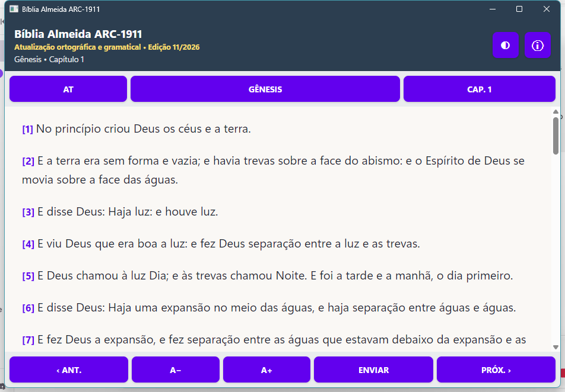

# Bíblia Almeida ARC-1911 — Aplicativo para Windows

## 📥 [BAIXAR PARA WINDOWS (clique aqui)](https://github.com/RomuloCSR/biblia-almeida-1911-windows-app/releases/latest/download/BibliaARC1911-Windows.zip)

**Gratuito • Sem anúncios • Funciona sem internet • Sem instalar • Sempre a versão mais nova**

Ou aponte a câmera do celular para o código abaixo e envie o link para o seu computador:


**Usar em 3 passos:**

1. Clique em **BAIXAR PARA WINDOWS** acima. O arquivo `BibliaARC1911-Windows.zip` será baixado.
2. Na pasta *Downloads*, clique com o botão direito no arquivo → **Extrair Tudo...** → **Extrair**.
3. Abra a pasta `BibliaARC1911` e dê **dois cliques** em **`Biblia.exe`**.

> Se aparecer a tela azul "O Windows protegeu o computador", clique em **Mais informações** e depois em **Executar assim mesmo**.

**Compartilhe com quem precisa:** copie e envie este link:

```
https://github.com/RomuloCSR/biblia-almeida-1911-windows-app/releases/latest/download/BibliaARC1911-Windows.zip
```

---

Aplicativo **gratuito, leve e 100% offline** da Bíblia **Almeida 1911 (Domínio Público)**, com atualização ortográfica e gramatical realizada em **11/2026** para o Português do Brasil.

Feito para quem quer ler a Palavra **sem distrações**: tela limpa, letra grande, botões simples. Se a pessoa sabe ler, ela sabe usar.

**Roda normalmente no computador de mesa (desktop) e no notebook, e também direto do pendrive — sem instalar nada.** A tela é a mesma em todos: o que você aprende num, já sabe usar no outro.

| Onde | Como usar | Instalar? |
|---|---|---|
| Computador de mesa (desktop) | dois cliques em `Biblia.exe` | Não |
| Notebook (com ou sem tela de toque) | dois cliques em `Biblia.exe` | Não |
| Pendrive, em qualquer computador com Windows | dois cliques em `Biblia.exe` | Não |



> **Nota editorial:** O conteúdo está em processo contínuo de atualização e pode eventualmente apresentar pequenas falhas ortográficas ou gramaticais. Colabore nos enviando seu feedback pela aba **Issues** deste repositório. Obrigado!

---

## Por que usar

* **Sem internet.** Os 66 livros e os 1189 capítulos já estão dentro da pasta.
* **Sem instalar nada.** É só extrair e dar dois cliques.
* **Desktop, notebook ou pendrive.** Funciona igual nos três, com a mesma tela.
* **Cabe num pendrive.** Leve a Bíblia no bolso e use em qualquer computador com Windows.
* **Motor em C.** Rápido e leve: cada capítulo abre na hora.
* **Não deixa rastros no computador.** O app guarda onde você parou numa pasta `dados` ao lado dele, e não no PC.
* **Sem anúncios, sem cadastro, sem coleta de dados.**
* **Texto fiel à Almeida 1911.** Só a grafia foi atualizada para o português de hoje, sem mudar o sentido.

### Ideal para

* Igrejas, cultos, estudos bíblicos, escolas dominicais e palestras.
* Telão e projetor: aumente a letra com **A+** e use o tema escuro.
* Regiões sem internet ou com internet ruim (interior, zona rural, aldeias, embarcações).
* Missionários e viajantes que precisam da Bíblia em português sempre à mão.
* Quem tem pouca intimidade com computador: os botões são grandes e claros.

---

## Como baixar e usar (sem instalar nada)

1. Clique em **[BAIXAR PARA WINDOWS](https://github.com/RomuloCSR/biblia-almeida-1911-windows-app/releases/latest/download/BibliaARC1911-Windows.zip)**. O arquivo `BibliaARC1911-Windows.zip` é baixado direto, sempre na versão mais nova. (As versões anteriores ficam na aba **[Releases](https://github.com/RomuloCSR/biblia-almeida-1911-windows-app/releases)**.)
2. Extraia a pasta baixada (clique com o botão direito no arquivo `.zip` -> **Extrair Tudo...**).
3. Abra a pasta `BibliaARC1911` e dê **dois cliques** no arquivo **`Biblia.exe`**.

### Levar no pendrive

1. Copie a **pasta inteira** extraída para o pendrive.
2. Em qualquer computador, abra o pendrive e dê dois cliques em **`Biblia.exe`**.

> Mantenha juntos, na mesma pasta: `Biblia.exe`, `WebView2Loader.dll`, a pasta `ui` e a pasta `textos`. Sem eles o app não abre.

### Abrir pelo terminal (CMD ou PowerShell)

```powershell
cd "E:\biblia-almeida-1911-windows-app"
.\Biblia.exe
```

Troque `E:\` pela letra do seu pendrive ou pelo caminho da pasta.

---

## Como usar

| Botão | O que faz |
|---|---|
| **AT / NT** | Troca entre Antigo e Novo Testamento |
| **Nome do livro** | Abre a grade com todos os livros |
| **CAP.** | Abre a grade com os capítulos |
| **‹ ANT.** e **PRÓX. ›** | Capítulo anterior e próximo |
| **A−** e **A+** | Diminui e aumenta a letra |
| **ENVIAR** | WhatsApp, Telegram, E-mail, X ou Copiar |
| **◐** | Tema claro, sépia ou escuro |
| **ⓘ** | Sobre o projeto |

**Dicas:**

* **Enviar só um versículo:** clique no versículo para marcar (ele fica destacado) e depois em **ENVIAR**. Dá para marcar vários.
* Ao enviar, o texto **também é copiado**. Se precisar, cole com `Ctrl` + `V`.
* O app **lembra** onde você parou, o tamanho da letra e o tema.

### Atalhos de teclado, mouse e toque

* **`←`** e **`→`** — Capítulo anterior e próximo.
* **`Ctrl`** + **`+`** / **`-`** (ou **`Ctrl`** + roda do mouse) — Aumenta ou diminui a letra.
* **`Ctrl`** + **`0`** — Volta a letra ao tamanho normal.
* **`Esc`** — Fecha a janela de livros ou capítulos.
* **Tela de toque** (notebook, tablet): deslize o dedo para os lados para trocar de capítulo.

---

## Requisitos

* **Windows 10 ou Windows 11** (64 bits).
* **Microsoft Edge WebView2 Runtime** — já vem instalado no Windows 10 e 11 atualizados. Se faltar, o app avisa. Baixe grátis no site da Microsoft: [Microsoft Edge WebView2](https://developer.microsoft.com/microsoft-edge/webview2/).

---

## Este aplicativo é seguro? (Sobre o aviso "O Windows protegeu o computador")

**Sim, 100% seguro.** Este é um projeto independente, gratuito e sem fins lucrativos, publicado em código aberto no **GitHub** (plataforma de referência mundial utilizada por desenvolvedores).

* **Por que o Windows SmartScreen exibe uma tela azul de aviso?** O Windows exibe esse alerta preventivo para qualquer programa novo que não tenha sido assinado por um certificado comercial pago nem publicado na Microsoft Store.
* **Como abrir tranquilamente:** Na tela azul do Windows, clique em **`Mais informações`** (logo abaixo do texto do aviso) e depois clique no botão **`Executar assim mesmo`**.
* **Transparência total (Código Aberto):** Todo o código-fonte (`motor/motor.biblia.c`, `src/app.cpp` e `ui/index.html`) e os textos dos 66 livros estão abertos e visíveis nesta página. Qualquer técnico ou programador pode inspecionar o código e confirmar que não há coleta de dados, rastreamento ou arquivos maliciosos.
* **Funciona sem internet.** O app só usa a internet quando **você** clica em **ENVIAR** (WhatsApp, Telegram, X) ou em **Abrir GitHub**.

> **Atenção, quem vive em locais com restrição religiosa:** o app não deixa arquivos no computador, mas o próprio pendrive e a pasta continuam visíveis para quem os examinar. Avalie os riscos do seu lugar.

---

## Para desenvolvedores

O app usa **o mesmo motor em C** da versão de terminal. O texto sai igual, letra por letra.

```
textos/*.md  ->  motor/motor.biblia.c  ->  src/app.cpp (janela)  ->  ui/index.html (tela)
```

| Pasta / arquivo | O que é |
|---|---|
| `motor/motor.biblia.c` | Motor de limpeza e atualização ortográfica (o mesmo do terminal) |
| `src/app.cpp` | Janela do Windows com WebView2 |
| `ui/index.html` | Visual do aplicativo (HTML, CSS e JavaScript) |
| `textos/` | Os 66 livros (1189 capítulos), texto base da Almeida 1911 |
| `kit/` | Arquivos do Microsoft WebView2 SDK (`WebView2.h` e `WebView2Loader.dll`) |
| `compilar.ps1` | Gera o `Biblia.exe` |

**Compilar** (com GCC / MinGW-w64):

```powershell
powershell -ExecutionPolicy Bypass -File compilar.ps1
```

---

## Outras versões

* [Bíblia Digital Almeida 1911 — Windows (terminal)](https://github.com/RomuloCSR/biblia-digital-almeida-1911-windows)
* [Bíblia Almeida ARC-1911 — Celular Android (APK)](https://github.com/RomuloCSR/biblia-almeida-1911-celular-android-apk)
* [Bíblia Digital Almeida 1911 — Linux](https://github.com/RomuloCSR/biblia-digital-almeida-1911-linux)
* [Bíblia Digital Almeida 1911 — macOS](https://github.com/RomuloCSR/biblia-digital-almeida-1911-macos)

---

* **Autor:** Romulo CSR ([github.com/RomuloCSR](https://github.com/RomuloCSR))
* **Apoio espontâneo (PIX):** `21980934118`
